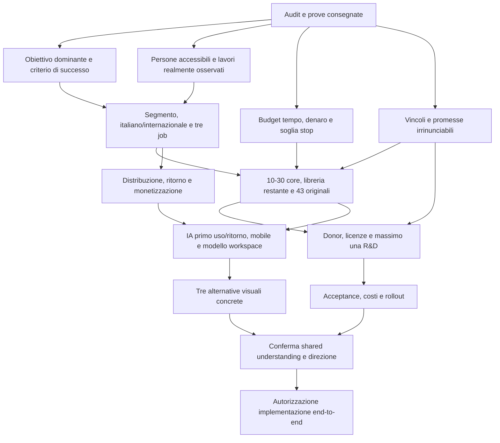

# Strumentini.it — rivalutazione indipendente

**Mandato:** CEO, strategia di prodotto, CTO e direzione UX. Audit del sito pubblico e del repository; nessuna implementazione, mutazione di produzione o modifica dei ticket. **Baseline locale:** `d0947cc278416ca966151eae516255b325477230`. **Sorgente distribuito dichiarato dal receipt:** `95be886`; versione Cloudflare verificata `6a1a5eaf-1091-45a7-a7c8-635c321877be`, 100%. Data di riferimento del mandato: 10 ottobre 2026. Gli orari effettivi delle nuove osservazioni sono registrati nel manifest delle prove; questa revisione può attraversare la mezzanotte.

**Stato del mandato complessivo:** audit consegnato nel perimetro esplicitato; grilling PENDING-OWNER, direzione e redesign non ancora approvati né implementati. Non è una certificazione Gold o una chiusura del progetto.

## Indice

1. [Verdetto e cinque errori principali](#1-verdetto-e-cinque-errori-principali)
2. [Metodo, autorità e limiti](#2-metodo-autorità-e-limiti)
3. [Mappa del prodotto e percorsi reali](#3-mappa-del-prodotto-e-percorsi-reali)
4. [Catalogo: valore e dispersione](#4-catalogo-valore-e-dispersione)
5. [Critica visuale e UX](#5-critica-visuale-e-ux)
6. [Scorecard indipendente](#6-scorecard-indipendente)
7. [Concorrenza, domanda e tre tesi alternative](#7-concorrenza-domanda-e-tre-tesi-alternative)
8. [Architettura, operazioni e costo del progresso](#8-architettura-operazioni-e-costo-del-progresso)
9. [Donor, dipendenze e build versus reuse](#9-donor-dipendenze-e-build-versus-reuse)
10. [Triage dei 43 originali](#10-triage-dei-43-originali)
11. [Contraddizioni documentali](#11-contraddizioni-documentali)
12. [Redesign: cambiamenti necessari e decision tree](#12-redesign-cambiamenti-necessari-e-decision-tree)
13. [Cinque outcomes condizionali](#13-cinque-outcomes-condizionali)
14. [Prove e verifiche residue](#14-prove-e-verifiche-residue)

## 1. Verdetto e cinque errori principali

**Esiste un prodotto utilizzabile, ma non esiste ancora una prova che l'attuale combinazione costituisca un prodotto desiderato e differenziato.** Alcuni motori completano lavori reali con file locali e download corretti. Non consiglierei di buttare quei motori. Non investirei invece un altro sprint nell'espansione del catalogo prima di scegliere quale problema e quale persona meritano l'esperienza migliore.

Il difetto più grave non è semplicemente una home brutta. Il prodotto dichiara un workbench personale, presenta una directory generica e non completa il meccanismo del ritorno: gli strumenti salvati persistono, ma gli usi verificati non alimentano i recenti. La promessa di riprendere anche i file è superiore alla funzionalità implementata. Una nuova grafica che mantenga questo scarto renderebbe più convincente una promessa ancora imprecisa.

| Errore | Prova | Conseguenza | Giudizio indipendente |
|---|---|---|---|
| Strategia senza scelta esclusiva | `PRODUCT.md`/`PRODUCT-SPEC.md`: workbench; home: categorie; backlog: fiscalità, Office, media, sicurezza PDF e parity concorrenti | Il successo di un motore viene confuso con avanzamento verso domanda e ritorno | Scegliere un obiettivo dominante e tre lavori; le alternative restano ipotesi |
| Differenziazione attribuita a funzioni già diffuse | ToopTools: workspace/pinning; SolveKit: suite/workflow; IT-Tools e CyberChef: utility locali | Local-first, account opzionale e catalogo ampio non bastano a giustificare una preferenza | Il vantaggio deve essere osservabile in un lavoro completo, non nell'elenco delle funzionalità |
| UX e promessa non corrispondenti | `/preferiti/` promette file e attività; `noteToolUse` ha zero chiamanti in `src`; dopo UTM reale “Riprendi” resta vuoto | Il prodotto perde proprio il motivo dichiarato per tornare | È un problema funzionale e semantico, non solo estetico |
| Trust più forte delle prove attuali | “Verificato” sul sito; validatore corrente: 259 receipt obsolete, 10 assenti, 2 non Gold; “Funziona ovunque” senza prove fisiche | L'utente vede una garanzia uniforme che il progetto stesso non sa sostenere sulla revisione corrente | Distinguere correttezza storica, prova attuale, limiti e disponibilità; non inferire che 259 motori siano guasti |
| Scope e processo di qualità mal accoppiati | Fingerprint globale include tutti i test/scripts, esclude `worker/`; zero workflow/run GitHub Actions; molti umbrella ticket | Una modifica estranea invalida quasi tutto mentre parte del backend non entra nella stessa identità di prova | Verifiche per dipendenze effettive + release integrata; conservare i gate che proteggono file, sicurezza e accuratezza |

**La mia tesi provvisoria:** un banco di lavoro italiano per preparare materiali da consegnare — PDF, CSV, immagini e piccoli controlli di testo — con 10–30 strumenti visibili, tre percorsi curati e un ritorno credibile attraverso strumenti e impostazioni. È una raccomandazione da discutere, non un nuovo requisito approvato. Anche questa tesi deve battere bookmark e concorrenti; potrebbe fallire se gli utenti vogliono solo una singola utility da Google.

## 2. Metodo, autorità e limiti

Ho letto integralmente i due mandati canonici, gli authority product/design, il dashboard/DAG e gli originali delle radici; ho confrontato codice condiviso, account Worker/D1, manifest, runtime, quality gate e prove storiche. I 43 ticket sono rappresentati singolarmente nel triage. L'inventario include tutti i 269 manifest, ma **non certifica 269 esecuzioni indipendenti**.

La repo non ha `tasks/index.md` né una terna locale corrente `goal.md`/`plan.md`/`worklog.md`; i documenti nominati dall'owner sono quindi il riferimento operativo per questo audit. Non è stato importato un task DStack globale estraneo. I documenti storici restano intatti; nessuna nuova autorità estetica o nuova decisione dell'owner è stata inventata.

Browser: Chrome locale reale, automatizzato con Playwright già installato, perché in questa sessione non c'è una superficie browser nativa disponibile. **13 superfici × 5 larghezze (320/390/768/1024/1440) × 2 temi = 130 navigazioni**, oltre alle interazioni. Le prime 104 osservazioni sono in `surfaces.json`; le 26 a 1024 px sono in `extra.json`. Tutte hanno risposto 200 senza overflow orizzontale superiore alla tolleranza di 2 px. Il tema è controllato nel DOM, non dedotto dalla preferenza del sistema. Ciò non prova usabilità, WCAG AA o hardware mobile.

Sono stati effettivamente eseguiti UTM, pulizia CSV, PNG palette exact, unione PDF, ricerca/zero risultati/Escape, onboarding/salvataggio/reload, cambio tema e validazione account. Gli input sono sintetici o fixture della repo. Nessun account è stato creato. La prova account ha impedito eventuali richieste non GET/HEAD; non ha ricevuto credenziali dell'owner né scritto in D1.

Tre letture delegate sono state avviate nel perimetro consentito dal mandato, poi interrotte da quota: le loro osservazioni sono state usate come piste e ricontrollate dove riportate come fatti. Non considero il loro lavoro una revisione esterna completa.

Etichette: **FATTO** = output nuovo o sorgente letto; **GIUDIZIO** = valutazione del reviewer; **IPOTESI** = da falsificare con utenti; **STORICO** = receipt precedente; **NON_VERIFICATO** = mancano dati o il percorso non è stato esercitato.

## 3. Mappa del prodotto e percorsi reali

| Superficie | Cosa esiste | Riscontro e limite |
|---|---|---|
| Home `/` | Ricerca globale, categorie, starter editoriali, recenti e inviti | Disponibile light/dark; directory domina la composizione, l'area personale non è il primo esito |
| Directory `/strumenti/` | 269 voci, filtri, categorie, suggerimenti di lavori | Navigabile; a 390 px pagina ~9.683 px. Un elenco completo non è una selezione utile |
| Categoria `/categorie/pdf/` | 31 tool nel gruppo pubblico | Featured + elenco; anche qui grandi superfici ripetute, ~9.170 px a 390 |
| Ricerca `/cerca/` e palette | Query, ranking deterministico, vuoto esplicito, navigazione tastiera | “unisci pdf” trova la utility corretta; focus nell'input e ritorno al trigger con Escape osservati |
| Onboarding `/onboarding/` | Contesti, lavori, starter spiegati e modificabili | Il percorso consulenza propone 10 tool; salvataggio persiste al reload, ma termina sulla home generica |
| Workbench `/preferiti/` | Lista installata, slot riprendi/recenti, suggerimenti | Salvati reali; riprendi vuoto dopo uso reale; nessun file salvato nel modello di stato |
| Account `/accedi/` | Login/registrazione, sync tool ID; Google predisposto nel codice | Pagina 200; bootstrap Turnstile fallisce, zero iframe. Login/sync autenticato NON_VERIFICATO |
| Settings `/impostazioni/` | Profilo, preferenze, tema, privacy e gestione | Cambio tema tramite UI funziona; statistiche dello spazio non sono retention o valore prodotto |
| Risorse `/risorse/` | Aiuto, privacy, qualità/account | Presente; copy tecnico e promesse da allineare ai limiti reali |
| Tool ordinari | 267 manifest LOCAL, 2 REFERENCE; 26 engine ID | Presenza e metadata verificati; supporto effettivo dipende da formato/input/browser |
| OCR immagini #246 | Route pubblica non elencata, `noindex,nofollow`, laboratorio | `/tools/ocr-italiano-locale-246/` è 200: non confondere “fuori catalogo” con DEV-only |
| Redaction #237 / OCR PDF #247 | Implementazioni sperimentali DEV-only | Produzione deve mantenerle 404; nessuna promozione implicita da questo audit |

### Tre lavori, quattro risultati realmente riaperti

| Lavoro | Azioni operative dal deep link | Risultato e controllo indipendente | Limite della prova |
|---|---:|---|---|
| Marketer compone URL UTM | 4 compilazioni + esecuzione + download = 6 | TXT scaricato; query `ref=cliente` e `#scheda` preservati, campagna con spazio corretta. URL non valido: errore e nessun vecchio risultato esportabile | Non è un benchmark utente e non include navigazione iniziale; trovare da home aggiunge apertura ricerca/scelta |
| Consulente pulisce CSV | File + esecuzione + download = 3 | BOM rimosso, terminatori delle righe normalizzati, CRLF interno a cella quotata e `00123` conservati; file 59→53 byte | Un fixture mirato; non prova tutte le codifiche, file enormi o tutti gli engine tabellari |
| Freelance prepara allegati | PNG: selezione modalità + file + esecuzione + download = 4; PDF: file multipli + esecuzione + download = 3 | PNG 64×48 RGBA: 12.437→192 byte, tutti i pixel/alpha identici con Sharp. PDF 2+3 pagine: download 1.870 byte, PDF.js riapre 5 pagine con testo `alpha, beta, one, two, three` in ordine | Rapporto PNG dovuto alla fixture sintetica facilmente comprimibile; non promettere -98% su foto. PDF semplici non coprono firme/form/XFA/PDF ostili |

Gli stessi casi sono riusciti a 390 e 1440 px. Tempi rilevati per PNG ~395–1.417 ms tra avvio ed esportazione; PDF ~295–315 ms nel harness. UTM ~414–960 ms include compilazione automatizzata e download. **Non sono P95, tempi di utenti o prove su smartphone.** Per CSV il controllo non si limita all'estensione del file: riapre il contenuto e verifica le celle sensibili.

Loading/abort verificati separatamente: 50 copie sintetiche della fixture PDF, CPU Chrome rallentata 8× per rendere osservabile lo stato, avvio→“Elaborazione in corso”→Annulla→stato annullato, **zero download**. Screenshot [loading](audit-2026-10-10/pdf-loading-390.png) e [annullato](audit-2026-10-10/pdf-cancel-390.png). È una prova UI su batch specifico, non certificazione di cancellazione/peak memory su tutti gli engine o su hardware mobile.

Nei percorsi controllati nessuna richiesta POST/PUT/PATCH di contenuti, nessun upload offsite osservato. Host: `strumentini.it` e, solo nella pagina accesso, `challenges.cloudflare.com`. Questo supporta la privacy di quei percorsi; non certifica ogni formato o eventuale trasporto futuro.

### Due rotture che incidono sull'identità

**Account — priorità alta nel perimetro live.** Tutte le 8 visite iniziali alla pagina accesso producono l'eccezione Turnstile: `Remove async/defer ... before using turnstile.ready()`. A 1024 e nel retry con campi validi sintetici la condizione si ripete. `src/pages/accedi.astro:281` carica con `defer`; `:382` usa `ready`. Il widget resta vuoto; il submit dice “Completa la verifica anti-bot e riprova”, senza una verifica da completare. La [documentazione ufficiale](https://developers.cloudflare.com/turnstile/get-started/client-side-rendering/) distingue `render` con callback/onload e `ready` in script non differito. **Non è il 404 di navigazione sull'endpoint JSON**. Il backend potrebbe essere corretto e rimanere irraggiungibile dall'interazione. Nessuna patch autorizzata in questa fase.

**Recenti — meccanismo non collegato.** `src/workbench/membership.ts:94` definisce `noteToolUse`, ma `rg -n 'noteToolUse' src` trova solo quella definizione; `recordRecentTool` compare nel modello e in quella funzione. Un contesto fresco esegue davvero UTM e poi visita `/preferiti/`: riprendi resta vuoto. Screenshot [recente dopo risultato](audit-2026-10-10/recent-after-result-390.png). Non attribuisco la prima osservazione all'onboarding che avrebbe cancellato dati: il retry è isolato. Inoltre `noteToolUse` non emette il broadcast della membership; un eventuale collegamento futuro deve verificare anche aggiornamento live e identità della persistence.

La sync salvati usa unione delle liste. È robusta contro una perdita di aggiunte offline, ma senza tombstone/semantica di rimozione una cancellazione locale durante guasto può riapparire da remoto. È **rischio di modello dal codice**, non un incidente riprodotto su due account reali. Chiarire “strumento salvato”, “recente”, “preset”, “file” evita di estendere questo modello oltre il suo contratto.

## 4. Catalogo: valore e dispersione

L'[inventario completo](audit-2026-10-10/catalog-review.csv) contiene tutti i 269 ID, engine, runtime, campi di profilo e una classificazione editoriale del reviewer. **Le classi sono ipotesi di investimento, non popolarità misurata né sentenze di guasto.** “Ridondante” indica sovrapposizione di job/interfaccia da riesaminare, non codice sicuramente duplicato. Non si propone cancellazione automatica o rottura di URL.

Il gruppo pubblico semplifica 14 categorie interne in 10 famiglie: immagini 21, PDF/documenti 31, file/media 28, testo 29, dati 25, date 22, sviluppo 36, marketing 22, ricerca 21, tariffe/clienti 34. Sono tassonomie, non segmenti utenti. Manutenzione dichiarata: 211 E, 41 H, 10 R, 7 D. Profilo dichiarato in 40 tool su 269; 229 non ne ricevono. Questo riduce il peso reale della tesi “default personali ovunque”. I `roleTags` diretti sono vuoti: esistono invece membership dei contesti curate separatamente; non dedurre che onboarding sia inesistente. Le stringhe `jobs` italiane sono spesso “Usa <nome>”, ma il search index conserva ulteriori keyword: non dedurre una ricerca rotta da quel campo soltanto.

Ripartizione editoriale primaria: 22 core candidati, 210 commodity utili, 12 accessori, 10 sovrapposizioni da rivedere, 3 con accettazione incompleta e 12 delicati da promettere in assoluto. Le ultime etichette non esauriscono tutti i gate: ad esempio resize è core candidato ma ha ancora acceptance fisica aperta. L'allegato ha flag separati e indica dove il risultato è stato riaperto in questo audit.

| Classe | Esempi e motivazione | Indicazione |
|---|---|---|
| Core candidato | CSV cleaner/map/dedupe, UTM, confronto testo, PDF merge/page selection, immagine compress/resize, metadati e manifest di consegna | Tre lavori coerenti possono dare una ragione concreta per preferire Strumentini; nessun singolo motore è dimostrato unico |
| Commodity utile | JSON formatter, unità, Base64, QR, hash, date | Conservare come supporto cercabile; competere su affidabilità e uso, non quantità |
| Accessorio | Lorem/sample, riferimenti HTTP/MIME, piccoli generatori CSS, convertitori di formato carta/TV | Basso investimento finché non compaiono nello stesso lavoro; nessuna prova di traffico SEO |
| Sovrapposizione da rivedere | quote counter/word counter; DOI normalizer/DOI-ISBN; list compare/intersection/difference; diversi rename/hash manifest | Un'unica superficie può offrire modalità senza una dozzina di schede; URL e casi d'uso vanno preservati o rediretti deliberatamente |
| Incompleto o dipendente | Image resize physical Gold, registratore microfono, codec image matrix/Office fidelity; OCR fuori catalogo | Promessa limitata e prova mancante esplicite. Una funzione bounded live non equivale alla chiusura del ticket |
| Pericoloso da promettere in assoluto | Metadati “sicuri”, secret scanner, anonimizzazione reversibile, password strength, PDF overlays; calcoli fiscali annuali | Nessuna garanzia “pronto da condividere/senza segreti/fiscalmente valido”. Metadati rimossi non significa assenza di dati sensibili; overlay non redazione |

Fiscalità italiana: alcune utility annuali INPS sono **già nel catalogo**, anche se #117 è aperto e vietare normative era l'intento v1. Non sostengo che siano prive di ogni fonte: occorre audit delle specifiche annualità, invalidazione e responsabilità. Il costo ricorrente non finisce con il primo fixture corretto.

## 5. Critica visuale e UX

Le [tavole desktop light](audit-2026-10-10/contact-1440-light-all.png) e [dark](audit-2026-10-10/contact-1440-dark-all.png) mostrano, nell'ordine: home/directory/categoria; search/onboarding/UTM; immagini/PDF/CSV; workbench/account/settings; risorse. Sono screenshot reali ridotti per confronto, **non alternative di design**.

| Osservazione concreta | Prova visiva / radice | Impatto |
|---|---|---|
| Il titolo potrebbe appartenere a qualunque toolbox | [Home 1440](audit-2026-10-10/home-1440-light.png), `HomeHero.astro`: “Strumenti semplici, utili davvero”, icone flottanti, blob, ricerca | Non identifica utente, lavoro o perché tornare; l'ornamento occupa il posto di un esempio di valore |
| Layout directory-first contro strategia workbench | Home: hero/trust/category prima di recenti; onboarding salva e torna alla home | L'utente genera il proprio spazio e incontra di nuovo la vetrina generale |
| Gerarchia per container ripetuti | Directory/categoria: card, bordi pastello, icone, contatori, pill, featured e altre card | L'importanza del compito non si distingue dal resto; la scansione richiede lettura di tanti blocchi equivalenti |
| Tipografia leggibile ma senza voce o contrasto gerarchico sufficiente | `global.css`: Inter per display/UI, 12–15px nei livelli minuti; quasi tutte le differenze da bold, blu e box | È un sistema coerente, ma non costruisce una firma visiva. Non basta sostituire il font |
| Risultato mobile arriva dopo controlli lunghi | [Image 390 completa](audit-2026-10-10/image-390-light-full.png), [CSV 390 completa](audit-2026-10-10/csv-390-light-full.png) | Su tool complessi serve continuità input→azione→risultato e posizione del nuovo output; non una colonna desktop semplicemente accodata |
| La compressione espone la decomposizione ingegneristica | PNG IDAT, palette exact/lossy, quality e metadata tutti visibili con note prima della conclusione | L'utente deve conoscere codec e ramo sperimentale per comprimere un allegato. Distinguere scelta di obiettivo da opzioni avanzate |
| Ornamentazione incongruente con il contratto visivo | Hero/tool art gradient, angoli/ombre locali; `WORLD.md` promette calma e minima decorazione | La stessa deriva torna su tutte le route: cambiarla a monte nel sistema, non correggere 269 pagine a mano |
| Fiducia come slogan ripetuto | Gratis/senza account/Verificato + quattro feature + FAQ + footer; account “sempre al sicuro” | Reiterazione occupa spazio senza chiarire i limiti importanti. Una nota vicino al file/risultato è più utile |
| La ricerca dedicata diluisce una risposta singola | Query “unisci pdf”: pannelli suggeriti/recenti/categorie prima della card trovata | L'utente ha già espresso un intento; mostrargli subito il risultato e un'apertura chiara |
| Il workbench ha forma di dashboard ma scarso stato operativo | [Workbench 390](audit-2026-10-10/recent-after-result-390.png): rail, hero “Riprendi”, poi stato vuoto | La composizione simula una ricchezza funzionale che non c'è ancora. Il percorso vuoto deve aiutare ad avviare un lavoro reale |
| Account è un pannello SaaS comune con un errore senza uscita | [Account bloccato](audit-2026-10-10/auth-blocked-390.png) | Il vantaggio promesso è sync di tool, il costo è registrazione; la gestione errore impedisce il beneficio |
| Aiuto scritto nel lessico dei gate | Wrapper: “contratto di esecuzione”, “oracolo e fixture”, “accesso alla rete vietato dal contratto” | L'utente non può interpretare una policy come sandbox. Spiegare dati inviati, limiti e controlli comprensibili |

Non confermo una critica storica inesatta: nel wrapper condiviso lo slot operativo viene **prima** dei blocchi FAQ e feature. Il problema è il peso complessivo e la genericità, più l'ordine di header/controlli in alcuni tool, non “tutto il testo SEO precede sempre il tool”.

A 390px: home ~5.878px, UTM ~5.308, immagini ~6.103, PDF ~5.020, CSV ~5.288. A 320px directory ~10.438 e categoria ~10.152. La lunghezza comprende footer e aiuto; non dimostra da sola un task lento. Combinata con card equivalenti e scarsa continuità del risultato, rende però evidente che la forma della pagina pesa molto più della semplice operazione.

Dark mode cambia correttamente le superfici e conserva la leggibilità principale. Non risolve la gerarchia: aumenta il rilievo di icone e gradienti; il testo secondario minuto resta debole. Il rispetto reduced-motion è campionato nei dati supplementari, non certificato sull'intero sito.

Accessibilità: la palette osservata prende/restituisce focus e ha vuoto esplicito; gli errori dei tool eliminano download precedenti. I form hanno molte label, gli stati ARIA esistono nel sistema. Il rilievo geometrico mostra link da 17–20px e checkbox da 13px: **non sono automaticamente violazioni WCAG**, perché target tramite label, spaziatura ed eccezioni vanno misurati. Contrasti, zoom, VoiceOver/TalkBack e traversal completo restano da accettare formalmente. Il colore faint `#7c8a9e` non va assunto AA su bianco solo perché appartiene al token sheet.

Il redesign deve rifare **architettura informativa, composizione, identità, modello di interazione, wrapper operativi, risultato mobile e sistema dei contenuti**. La base di engine/output/privacy è un'invariante tecnica da verificare, non il vincolo a tenere i container attuali.

**Contrasto effettivamente misurato:** `/accedi/`, nota “La sessione resta attiva per 30 giorni su questo browser”: CSS computato 13px, `rgb(124,138,158)` su `rgb(255,255,255)`, rapporto **3,508:1**. È sotto il requisito 4,5:1 per testo normale di [WCAG 2.2 1.4.3](https://www.w3.org/WAI/WCAG22/Understanding/contrast-minimum.html). Non richiede una preferenza estetica per essere corretto; la conformance totale rimane non provata.

## 6. Scorecard indipendente

Scala soggettiva 0–5, non scientifica. Zero = assente/inadeguato; tre = utilizzabile con difetti; cinque = esperienza eccellente sostenuta da prove. Una dimensione senza dati non riceve un punteggio di mercato inventato.

| Dimensione | Valutazione | Ragione e limite |
|---|---:|---|
| Utilità | 3,5 | Quattro output reali corretti, ampia infrastruttura; non tutti i tool provati e poco focus sui lavori |
| Differenziazione | 1,5 | Workspace/local-first sono già disponibili; non misurato il vantaggio delle tre catene proposte |
| UX | 2 | Search utile e salvati persistenti; onboarding→home, recenti scollegati e account bloccato colpiscono il ritorno |
| Craft UI | 1,5 | Coerenza tecnica ma visual generic, decorazioni e gerarchia ripetitiva. Non ha l'identità richiesta dall'owner |
| Fiducia/trasparenza | 2 | Refusal e limiti tecnici seri; badge/copy e freshness delle prove si contraddicono |
| Performance/mobile | 2,5 | Nessun overflow nelle 130 viste, task piccoli rapidi su Mac; hardware, peak memory e P95 assenti |
| Accessibilità | 2,5 provvisorio | Focus/errori campionati e primitives; nessuna attestazione AA, audit assistivo completo non eseguito |
| SEO/discovery | 2,5 tecnico | Route, catalogo e metadata; nessuna prova Search Console, ranking o acquisizione. FAQ template poco distintive |
| Monetizzazione/retention | NON_VALUTABILE | Nessuna coorte o revenue verificata, telemetria inattiva, definizioni metriche errate per retention |
| Sostenibilità tecnica | 2,5 | Static-first valido, riuso già presente; troppo scope, gate globali e motori delicati custom |

I voti più bassi del precedente handoff su differenziazione e UX derivano da due prove nuove: concorrenti correnti con workspace e ritorno/account che non completano la promessa. La qualità tecnica dei singoli output non è stata abbassata per associazione.

## 7. Concorrenza, domanda e tre tesi alternative

Le pagine dei concorrenti sono fonti sulle loro **offerte dichiarate**, non una certificazione dei loro motori, della privacy o del successo economico. Non dispongo dei loro utenti/revenue. Non equiparo il marketing “locale” a un audit di rete.

| Confronto corrente | Cosa sottrae alla tesi Strumentini | Dove può rimanere spazio |
|---|---|---|
| [ToopTools](https://tooptools.com/) | 200+ utility, workspace personalizzato e pinning: il meccanismo workbench non è originale | Scelta di lavori italiani e qualità di continuità/output; da misurare |
| [SolveKit](https://usesolvekit.com/) | 220 utility e suite di workflow: collegare strumenti non è una scoperta sufficiente | Un percorso specifico e affidabile su file reali, con limiti più comprensibili |
| [FreelTools](https://freeltools.com/) | 244 tool e posizionamento freelancer/agenzie: quel target non produce da solo un vantaggio | Segmentare per situazione operativa e risultati, non chiamarsi semplicemente “OS del freelance” |
| [PDF24](https://tools.pdf24.org/en/) e [iLovePDF](https://www.ilovepdf.com/) | Cataloghi PDF specialistici, marchi e navigazione per azione | Lavori che coinvolgono insieme PDF/CSV/immagini e richiedono mantenere i file locali; non dimostrata superiorità di affidabilità |
| [IT-Tools](https://github.com/CorentinTh/it-tools) | Commodity di sviluppo già gratuita e OSS | Non giustifica sviluppare un'altra directory equivalente come nucleo commerciale |
| [CyberChef](https://gchq.github.io/CyberChef/) | Composizione locale di operazioni e ricette già disponibile | UX meno tecnica e lavori curati per chi non costruisce ricette |
| [AvvocatoAndreani](https://www.avvocatoandreani.it/risorse/index_servizi.html) | Utility professionali italiane e autorità di dominio: competere in fiscalità ha un costo di fiducia/manutenzione | Non entrare nel verticale normativo per inseguire parity senza owner competente |
| [Squoosh](https://squoosh.app/) | Compressione locale con confronto immagine centrato sull'operazione | È anche riferimento d'interazione: file→controlli→confronto→download, non decorazione prima del task |

Bookmark, Raycast/Alfred, browser e assistenti AI restano sostituti: un bookmark già riduce il costo di trovare il tool; il valore di un workbench deve quindi venire da default utili, continuità reale e risultato. Gli LLM possono sostituire molte risposte testuali semplici; dati tabellari, file locali, esportazioni deterministiche e verificabili rimangono un territorio più credibile. Questa è un'inferenza strategica, non una previsione di domanda.

Il riferimento storico [smarterfaster](https://www.smarterfaster.app/) cambia significato nel sito corrente: dashboard nativa Mac, macOS 12+, prezzo dichiarato $49 una tantum, board/link/app/cartelle e dati locali, Windows in sviluppo. Non riporto il vecchio numero “43 pack” come fotografia attuale. È un sostituto per organizzazione personale, non lo stesso prodotto web di engine deterministici. Il dominio esatto con `www` è stato verificato dopo tentativi su domini errati: non deduco assenza del concorrente da quei fallimenti.

**Giudizio visuale:** Squoosh vince nel comunicare subito ingresso e confronto; PDF24/iLovePDF rendono riconoscibile l'azione documentale; CyberChef mostra una macchina operativa. Non attribuisco loro AA, migliore privacy o migliori tempi senza equivalenti prove. Per Strumentini sono riferimenti di chiarezza del compito, non layout da clonare. Acquisizione reale, ranking e quota di mercato di tutti i concorrenti sono NON_VERIFICATO.

### Tre alternative di prodotto, non tre palette

| Tesi | Promessa e meccanismo | Costo stimato del primo esperimento, oltre redesign | Falsificazione in 30 giorni |
|---|---|---|---|
| **A — workbench curato per chi prepara consegne** (raccomandazione) | Tre lavori PDF/CSV/immagini-testo, 10–30 strumenti, default e recenti reali; il catalogo è supporto | 20–40 ore tra reclutamento/osservazione/misurazione e correzioni circoscritte, non sviluppo di codec nuovi | Reclutare 8–12 persone con lavori ricorrenti; almeno 6 completano senza assistenza, almeno 4 tornano in un giorno diverso, almeno 3 preferiscono il percorso al proprio metodo. Soglie proposte, non risultati |
| **B — directory SEO di utility gratuite** | Risposta rapida a query/deep link, catalogo italiano e pagine eccellenti per singolo intento | 20–40 ore di selezione query/pagine/Search Console; volume organico richiede più di un mese e nessuna garanzia | 30 giorni servono a provare indexing e completion sui primi ingressi. Se non ci sono impression/visitatori, non pretendere di aver falsificato SEO; un test diretto con utenti può falsificare UX ma non acquisizione |
| **C — verticale documentale locale** | Preparare allegati affidabili e condivisibili; pochi formati/job, niente conversioni illimitate | 30–60 ore di corpus/benchmark specialistico; Office ricco/redaction richiedono budget a parte | Cinque job scelti, 20 documenti autorizzati/sintetici, confronto con metodo attuale: nessuna perdita non dichiarata e beneficio osservato in almeno tre job. Se richiede sempre un'altra suite per finire, la promessa va ristretta |

A ha il rischio di inventare un bisogno di workspace dove bastano bookmark; B ha competizione e dipendenza dal canale; C affronta incumbent forti e file difficili. **Lo stop/pivot parziale rimane una possibilità legittima** se nessun lavoro produce preferenza. Il redesign è deciso dall'owner; la tesi di business non è automaticamente validata dal rifacimento.

Non consiglierei monetizzazione iniziale automatica. Pubblicità, sync a pagamento, preset/pro/team sono modelli diversi con diversi motivi di pagamento. Il codice non prova willingness to pay. Conservare utility normali gratuite e local-first è una proposta coerente con la baseline; prezzo e modello vanno decisi dall'owner dopo scelta dell'obiettivo.

### Distribuzione, SEO e misurazione

Il sito ha URL per tool, metadata e sitemap di build; il validator passa gli aspetti strutturali. Ho osservato pagine pubbliche e query corrette, non Search Console o ranking. Non confondere “indexabile” con “indicizzato”. I 284 URL sitemap citati nel receipt sono storici, non un conteggio fresh di Google. L'onboarding da deep link deve venire **dopo il primo risultato**, quando è utile salvare qualcosa. Il contesto di professione non deve diventare una pagina SEO vuota.

Una strategia italiana iniziale è plausibile per copy/supporto/reclutamento, ma non una decisione nuova. Internazionalizzare ora moltiplicherebbe metadata, copy, fixture semantiche e supporto senza dati sul canale. Meglio scegliere il mercato prima di implementare locale aggiuntive.

La telemetria di validazione è inattiva nel sito osservato. Inoltre `TelemetryBootstrap.astro` non configura un subject ID; il reporting ignora eventi senza `subjectId`. `returnMetric` conta un'apertura da workbench un minuto dopo attivazione come ritorno nel periodo: **non è retention D7/D30 di una coorte matura**. `reusedToolCount` è il numero di tool usati da almeno due soggetti, non il riuso dello stesso soggetto. Attivare questo sistema senza correggere definizioni e identità darebbe dati difficili da interpretare, non validazione.

Cinque misure proposte: completion di un job con output valido; tempo ingresso→primo risultato utile; origine dell'avvio (ricerca/deep link/area); ritorno in giorno diverso di soggetti consenzienti con coorti mature; errori/refusal/annullamenti per formato. Nessun filename, URL inserito, contenuto, output o profilo nella telemetria. Il budget privacy e il consenso restano decisioni esplicite.

## 8. Architettura, operazioni e costo del progresso

### Decisioni tecniche che difenderei

Astro statico + Preact sui tool, registry noto a compile time, motori condivisi, contratto typed di risultati e handoff, file elaborati localmente, refusal per fedeltà non sostenibile e backend account separato sono una base adeguata. Riscrivere in Next/React full-stack non risolve il problema di prodotto e introdurrebbe una migrazione inutile. Il frontend statico è portabile; il backend account Worker/D1 richiede adattatore se cambia provider.

I risultati hanno classi utili e verificatori di artifact; le nuove prove riaprono output veri. Ci sono guardie sulle route DEV e sui source pack. Sono asset da preservare. Non significa che ogni parser custom sia il migliore investimento futuro.

### Decisioni da contestare

1. **Fingerprint troppo ampio e troppo stretto insieme.** `scripts/lib/current-revision.ts` include package/config, tutto `src/`, `tests/`, `scripts/`, fixture/oracle e `public/`. Una variazione non pertinente invalida moltissime receipt. Esclude `worker/` e le migration: una modifica auth non cambia quella stessa identità delle prove. Serve separare piattaforma, tool/engine, runtime asset e backend, con un'identità aggregata per release. Non disabilitare la freshness per far passare il gate.
2. **Badge costruiti da stato storico.** `goldToolIds` esamina il quality index; il wrapper non confronta fingerprint corrente. Il gate è onesto nel riportare BLOCKED, il frontend sembra più certo. Occorre definire semantica visibile e data/perimetro delle prove; non semplicemente ricalcolare 269 badge verdi.
3. **“Rete vietata” è contratto, non isolamento.** `tool-runtime.ts` carica l'engine e invoca `run`, non disabilita `fetch` tramite sandbox. I test di rete e le prove sono la protezione effettiva nel percorso attuale. La shell può interrogare sessione; ciò non è upload di file. L'utente deve capire la distinzione senza lessico interno.
4. **Recenti scollegati e sync come union-only.** Sono difetti di modello centrali al workbench. Aggiungere cronologia di file o team prima di chiarirli amplificherebbe l'ambiguità.
5. **Qualità come numero di ticket.** #018 è parity con CalcolaTutto, non un outcome utente. #046 certifica tutta l'espansione: può restare aperto senza impedire l'esistenza di un prodotto con perimetro più piccolo e accettato. Chiudere un umbrella richiede rispettare gli AC o un de-scope deliberato; la proposta non cambia lo stato.
6. **Verifica manuale senza CI remota osservabile.** Query fresca GitHub Actions: zero workflow e zero run. La repo ha molti comandi/test, ma non evidenza di protezione remota eseguita automaticamente. Non affermo che l'owner non possa avere altri sistemi di CI: non verificati.

### Stato operativo fresh

| Controllo | Risultato | Interpretazione |
|---|---|---|
| Git baseline | main pulita, singola worktree/branch, stash vuoto, origin allineato | Nessun WIP Git da “consolidare” di nuovo; questa consegna aggiunge solo documentazione/prove |
| `tickets:check` | PASS: 327/284/43, 17 refusal, zero mismatch | Integrità del backlog, non proof di funzionalità |
| `validate-release --no-write-receipt` | BLOCKED: 0 errori, 7 blocker, 0 warning | 10 receipt assenti, 2 non Gold, 259 stale; browser/physical/rollback non attuali |
| Cloudflare status/list | Versione live 100%; precedente `32956b26-6c3c-4a22-92c5-ae29be8e7f65` presente | Rollback disponibile in cronologia, nessun rollback esercitato e gate freshness ancora aperto |
| D1 info | 5 tabelle, 73.728 byte, EEUR; contatori 24h riportati 0 | Configurazione presente; i contatori non sono un numero utenti e non provano assenza di uso |
| Session API | fetch/curl 200 JSON `user:null`; `Sec-Fetch-Mode:navigate` 404 HTML | Routing statico Cloudflare navigation-first coerente con [SSG docs](https://developers.cloudflare.com/workers/static-assets/routing/static-site-generation/); non prova DB autenticato |
| Dipendenze prod note | `npm audit --omit=dev`: zero advisory riportate | Non prova assenza vulnerabilità, licenza o correttezza, soprattutto WASM vendored |
| Device | iPhone fisico collegato, `adb` assente nel PATH | Prova fisica NON_RUN; iPhone raggiungibile non significa Web Inspector/picker/download verificati |

Durante la scrittura del rapporto il secondo validator read-only rileva anche `WORKTREE_DIRTY` per i nuovi documenti non ancora committati: **8 blocker transitori**, nessun errore strutturale. Il baseline pulito aveva 7; la consegna documentale non aggiunge prove Gold né altera la sorgente distribuita. `verification.json` conserva quel risultato anziché fingere un checkout pulito mentre si scrive.

`handleSession` cattura errori di ricerca sessione e può rispondere `user:null`: un 200 anonimo non è health check D1. Una SELECT di schema remota tentata nella lettura delegata è stata rifiutata per autorizzazione; non è stata aggirata né viene usata come prova di migration applicate. Nessun dato personale è stato estratto.

Auth dal codice: PBKDF2 SHA256 con 600.000 iterazioni, token casuale con hash server-side, cookie Secure/HttpOnly/SameSite Lax, limite tentativi e body limit. Sono scelte sensate; latenza reale login, recupero account, controllo completo CSRF/cookie, sync tra device e costi CPU non certificati. Il costo Free Worker ha 10ms CPU per invocazione: verificare il budget del KDF sul piano effettivo, non presumere gratuità dell'account. Non sto riportando una vulnerabilità sfruttabile sulla base dell'assenza di una singola header.

### Perché il progresso costa troppo

Il costo nasce da tre fattori: troppi domini indipendenti, engine/fidelity difficili e ripetizione di verifiche/global invalidation. Il receipt storico documenta 1.791 test in 233 suite, check su 1.949 file e build 291 pagine; non li ho rieseguiti per un audit documentale. `npm test/check/build` invocano anche generatori e gate sovrapposti. La cronologia deployment osservata contiene molte promozioni nello stesso giorno: un freeze con batch e checks pertinenti potrebbe ridurre ricostruzioni, stale receipt e canary con asset mischiati.

Il volume su disco rilevato è ~5,6 MiB engine, 9 MiB test, 1,7 MiB scripts, 33 MiB quality e 26 MiB asset OCR. Non è costo runtime della home. Non dispongo di timesheet o fatture token: **non invento ore spese né risparmi retroattivi**. I problemi storici di Mac carico e worktree frammentate sono documentati nei receipt; non costituiscono una diagnosi della macchina attuale.

Proposta: un solo integratore, prove di tool/engine toccato per tranche, una matrice cumulativa in release candidata; sicurezza PDF, file-output e limiti fisici non ridotti. Scegliere un donor dove riduce il codice proprietario delicato, non aggiungere una dipendenza senza eliminare davvero il ramo sostituito.

### Costi: hosting economico, manutenzione costosa

Le [tariffe Cloudflare Workers](https://developers.cloudflare.com/workers/platform/pricing/) riportano asset statici gratuiti/illimitati; Free 100k invocazioni dinamiche/giorno con 10ms CPU; Paid minimo $5/mese con 10M richieste e 30M CPU-ms inclusi. [D1](https://developers.cloudflare.com/d1/platform/pricing/) Free: 5M righe lette/giorno, 100k scritte/giorno, 5GB; Paid include quote più alte e fattura gli eccessi. Sono prezzi ufficiali, **non la fattura di questo account**. Dominio, mail/transazioni, eventuale supporto/licenze, token e ore dell'owner non sono misurati.

Scenari: frontend statico soltanto può restare $0 hosting oltre dominio; account di basso volume può rientrare Free **solo se** KDF/limiti e usage lo consentono; Paid parte da $5, con formula sugli eccessi. Un eventuale MuPDF commerciale o supporto Zeta è un preventivo separato, non incluso. Il rischio economico principale oggi è dedicare decine di ore a Office/OCR/fiscalità senza un motivo d'uso verificato. Budget e soglia stop del prossimo esperimento devono precedere lo spike.

## 9. Donor, dipendenze e build versus reuse

Ricerca su repository primari, npm registry e file ufficiali. Snapshot di versioni, package-size e ultime push è negli artifact. La data `pushed_at` non equivale a release stabile, qualità o manutenzione di ogni codec. La query GitHub anonima era rate-limited; la lettura `gh api` autenticata ha fornito metadata senza esporre credenziali. Nessun package è stato installato né aggiunto al lockfile.

| Donor | Evidenza/versione/licenza | Cosa adottare o eliminare | NO-GO / costo da verificare |
|---|---|---|---|
| **[jSquash](https://github.com/jamsinclair/jSquash)** | Apache-2.0 wrapper; JPEG 1.6.0, WebP 1.5.0, AVIF 2.1.1, OxiPNG 2.3.0 nel registry. Ultima push repo 2026-01-05. API WebP espone `lossless`, `method`, `exact`, `alpha_quality` | Prima scelta per #047: evitare encoder JPEG/WebP manuali; conservare adapter, metadata policy e verifiche output. OxiPNG possibile alternativa al ramo IDAT, dopo equivalenza | Non promuovere senza codec/transitive notices, dimensioni, Safari, worker/CSP, pixel/alpha, lazy/offline. README segnala Vite optimizeDeps/nested workers. Performance qui NON_RUN |
| **[Squoosh](https://github.com/GoogleChromeLabs/squoosh)** | Apache-2.0; repository corretto GoogleChromeLabs, push 2026-10-07, app locale | Riferimento reale per confronto/input→output e codec. Preferire moduli invece di forkare tutto il prodotto | Fork completo porta build/analytics/UI propria; immagini locali non significa assenza analytics. Non importare shell/tracking automaticamente |
| **[Libre Convert](https://github.com/Rhgx/libre-convert) + [zetajs](https://github.com/allotropia/zetajs)** | Wrapper MIT, push 2026-10-09; zetajs MIT, helper vendored 1.2.0, push upstream 2026-04-01. Runtime Office con licenza separata | #056: eventuale conversione Office ricca mediante LibreOffice, evitando ricostruire layout/fonte/font manualmente; il printable attuale conserva un altro scope | NO-GO finché runtime licenziato/pinnabile/self-hosted, fidelity corpus, font, memoria, mobile, abort e COI provati. Nessun benchmark/fedeltà eseguito in questo audit |
| **[PDFStudio/qpdf](https://github.com/fayazara/pdfstudio)** | **Già vendored 0.4.0**, PROVENANCE con hash tarball/WASM; wrapper/qpdf Apache-2.0, zlib/IJG notices. Push repo 2026-07-11 | Ampliare solo se utile il riuso per merge/split/repair/encryption rispetto a parser/writer custom; è già impiegato per sblocco con password | Non offre prova universale di redazione sicura. Comparare campi, firme, resource limits e output prima di sostituire path che già funzionano |
| **[PDF.js](https://github.com/mozilla/pdf.js)** | Apache-2.0, `pdfjs-dist` 6.4.299 già presente, push 2026-10-10 | Reader/render/extract/oracle indipendente; ha riaperto i nostri PDF scaricati | Non è un writer/redactor universale. Package unpacked ~34,9MB non è payload iniziale: servono chunk e worker effettivi |
| **[MuPDF.js](https://github.com/ArtifexSoftware/mupdf.js)** | npm `mupdf` 1.28.1 AGPL-3.0-or-later; repo AGPL, push 2026-07-01; [licenza commerciale Artifex](https://artifex.com/licensing) alternativa | Possibile motore specialistico PDF/render/redaction; riduce implementazione custom delicata | NO-GO se modello proprietario/licenza incompatibile o manca revisione sicurezza/output. Non dichiarare “redaction sicura” per la sola scelta di libreria; preventivo non acquisito |
| **[libheif](https://github.com/strukturag/libheif) / [heic-to](https://github.com/hoppergee/heic-to)** | heic-to 1.6.5 già installato, LICENSE LGPL-3.0-or-later; libheif core LGPL, plugin/codec con condizioni proprie. Push 2026-10-01 / 10-10 | Decodifica HEIC prima di qualsiasi decoder nuovo; usare path CSP supportato se necessario | Non assumere MIT dal wrapper. Metadata/orientamento/multipagina/iPhone reali, transitive e codec/patent scope da verificare; non una garanzia di ogni HEIC |
| **[SVGO](https://github.com/svg/svgo)** | MIT, 4.1.0 già presente, push 2026-08-27 | #047 SVG multipass/config e rendering equivalente; nessun ottimizzatore SVG originale nuovo | Optimizzazione può cambiare viewBox/ID/referenze: input ostili e sicurezza SVG non risolti dalla sola minificazione |
| **[Spectrum Web Components](https://github.com/adobe/spectrum-web-components)** | Apache-2.0, team Adobe, push 2026-10-09 | Riferimento di primitives/stati/tokens, possibile riuso selettivo dopo confronto con Preact e sistema locale | Non adottare una skin Adobe o seconda infrastruttura UI per “fare premium”. Peso, theming, custom-elements/a11y integration NON_RUN; primitivi esistenti prima di nuova libreria |

Dimensioni npm unpacked verificate: jSquash JPEG ~0,53MB, WebP ~0,91MB, OxiPNG ~0,45MB, AVIF ~8,36MB. **Non sono i byte scaricati dal browser**: includono varianti, decoder/encoder e file. L'inventario dei tarball documenta i singoli WASM e byte; tempi cold/warm, peak memory e sandbox CSP su Cloudflare non sono stati misurati. JPEG/WebP sono uno spike più proporzionato che caricare tutti i codec insieme. Richiedere self-hosting degli asset scelti e pin/hash.

WASM non compresso rilevato nei tarball ufficiali: encoder MozJPEG 251.524 byte; encoder WebP base 281.261 e SIMD 345.584; OxiPNG seriale 164.172 e parallelo 236.042; AVIF encoder base 3.485.872 e multithread 3.534.665. Occorre scegliere la variante e verificare l'eventuale requisito SharedArrayBuffer/COI: non tutta la libreria deve essere multithread. Il manifest licenze è candidato, non ancora una distinta legale completa degli oggetti compilati.

### Perché Libre Convert non si copia semplicemente

HEAD fresh del runtime `soffice.wasm` 36.279.250 byte e `soffice.data` 15.891.013 byte, entrambe risposte `content-encoding:br`: **52.170.263 byte, ~49,75 MiB compressi** prima di font/helper/altro. Last-Modified riportato 13 maggio 2025, URL `zetaoffice_latest`, non una versione immutabile. A 10Mbps la sola trasmissione di quei due asset ha limite inferiore ~42 secondi, esclusi RTT/decompressione/compilazione; è un calcolo, non un tempo misurato.

Il [service worker del donor](https://raw.githubusercontent.com/Rhgx/libre-convert/main/public/sw.js) cancella cache di altri nomi all'attivazione, memorizza tutte le GET same-origin e aggiunge COOP/COEP. Copiarlo sul dominio account potrebbe memorizzare risposte API e interferire con cache esistenti. Il runtime è cached-once/non revalidated. Il fatto che giri su un host statico non significa compatibilità innocua con login/Google/servizi del sito. Isolare scope/origin e policy sarebbe necessario, se il bisogno giustifica il lavoro.

zetajs è MIT, ma **non licenzia tutto soffice.wasm**. Le sue fonti collegano LibreOffice distro zeta, Emscripten e Qt: il software contiene componenti con condizioni distinte. [ZetaOffice](https://zetaoffice.net/) dichiara self-hosting e servizi CDN/supporto, ancora in beta; non deduco un diritto commerciale perpetuo al CDN dai download accessibili. La distinta completa delle licenze/runtime e il diritto di redistribuzione di quello specifico binary sono NON_VERIFICATO. Decisione: nessuna integrazione finché questa due diligence non è chiusa.

### Riuso realmente trascurato

Il progetto **non ha ignorato tutti i donor**: fflate, SVGO, heic-to, PDF.js e PDFStudio sono presenti; OCR usa asset Tesseract locali. La critica corretta è non avere reso sistematico il confronto prima di implementare alcuni rami sofisticati. jSquash/Squoosh meritano una valutazione prima di completare #047; qpdf già vendored merita confronto prima di estendere parser PDF; Office ricco deve passare da motore mantenuto o refusal, non dalla promessa di scriverne uno rapido.

Uno spike dovrebbe eliminare una precisa responsabilità locale, produrre artifact confrontabili e terminare entro un budget: JPEG/WebP 1–2 giornate proposte; Office 2–3 solo dopo licenze/pinning; PDF sicurezza con revisore esterno non stimabile come microticket. Nessun donor è stato approvato dal presente audit e nessuna modifica è stata avviata.

## 10. Triage dei 43 originali

**I ticket restano nello stato originale.** La tabella nell'[allegato completo](audit-2026-10-10/ticket-triage.md) riporta tutti i 43, le dipendenze ancora aperte, fonte e proposta specifica. Non viene rigenerato il dashboard per farlo sembrare più verde. 5 ready + 31 dependency + 2 source + 5 physical = 43. Le 17 refusal fra i 284 chiusi non sono funzionalità vendute.

### Le dodici radici e il valore da sbloccare

| Radice | Verificato / già costruito | Cosa manca | Decisione e raccomandazione |
|---|---|---|---|
| #047 | PNG IDAT/palette exact/lossy nel prodotto; nuova prova RGBA e download | JPEG expert, WebP lossless/effort, SVG multipass/preview e corpus/perf/device | Se immagini nei tre lavori core: unico primo spike jSquash, poi SVGO già presente. Non scrivere codec manuali per completare caselle |
| #056 | Printable TXT/MD/HTML/CSV bounded; refusal reale rich Office; challenge corpus OOXML | Motore layout, fidelity reference, font, layout/documenti complessi, device | Sospendere Office ricco finché è dimostrato necessario e donor/licenza praticabili. Non chiamare rendering fedele l'estrazione semantica |
| #212 | GIF primo frame con offset/interlaccio, consent per perdita animazione, prove storiche indipendenti | HEIC iPhone reale/orientamento, AVIF encoding portabile, animazione/metadata, risorse fisiche | Secondo solo se job richiede input iPhone. Riutilizzare libheif/heic-to; nessuna promessa universale da un decoder riuscito |
| #237 | Raster-only, assenza marker/oggetti nei casi verificati; fix `/Parent` per PDFKit, solo DEV | Sign-off indipendente, corpus ostile/rotazioni/trasparenze, memoria/cancel hardware | Mantenere non pubblico. Non “sbloccare” per lanciare il redesign. Revisione esterna se entra nella promessa commerciale |
| #246 | Italiano PNG sperimentale locale, rotazione scelta dall'utente, Tesseract/asset | Corpus reale, skew/orientamento automatico, qualità/confidence, peak memory/cancel/device | Fuori core iniziale salvo evidenza scanner. Chiarire esposizione noindex pubblica e laboratorio; non confonderla con nessun deploy |
| #115 | Snapshot ufficiali parziali/date-exact e storico supplementare con hash/provenienza | Completezza code/periodi comuni soppressi e stati esteri; nessuna inferenza di codici mancanti | Sospendere catena CF salvo job reale. Una riga mancante è motivo di refusal, non ricostruzione creativa |
| #117 | Framework reference/versioning e sottoset annuali; non fonti complete dell'intero scope | Set coerente annuale IVA/IRPEF/INPS/forfettario/TFR e freshness/rollover per promesse offerte | Sospendere espansione fiscale finché c'è owner normativo. Non chiedere all'utente di inventare aliquote: i fatti si ricercano |
| #229 | Registratore nel catalogo e prove mocked/storiche di deny/revoke/output | Permission UI, microfono vero, capture/play/download su hardware | Solo se recorder è core; WebDriver mock media non prova microfono fisico |
| #277 | Runner/criteri Android resize esistenti | Device Android e percorso picker→output fisico | EXTERNAL: target/tooling non verificati. Nessuna emulazione promossa |
| #278 | iPhone collegato nel controllo fresh; tentativo storico Web Inspector disabilitato | Stato Web Inspector corrente e picker/resize/download reale | PENDING verifica fisica. Non scrivere “iPhone assente”: l'indisponibilità storica è superata |
| #280 | Contratto lane Android heavy-tool | Progress/abort/memoria/output dei job pesanti su device | Attivare matrice sul perimetro scelto, non tutti i formati senza domanda |
| #281 | Contratto lane iOS heavy-tool | Files/Photos/share/download, pressione memoria/cancel Safari fisico | Uguale; Safari desktop a 390px non sostituisce il telefono |

Le fonti #115 sono migliorate rispetto alla prima nota dell'issue: **non usare i primi numeri dei gap come fotografia finale**. I nuovi snapshot a date puntuali e il supplemento ANPR non chiudono tutti gli intervalli storici/codici esteri. Per una futura chiusura leggere l'ultima evidenza e gli AC originali, non questo riassunto come dataset.

### Vera catena prioritaria

Le priorità di prodotto **non coincidono con la frontier numerica del scheduler**. Ordine raccomandato, nessun nuovo ticket:

1. Accettare un perimetro live credibile: account bloccato, recenti e promesse/badge sono i primi difetti da affrontare quando sarà autorizzato sviluppo. Conservare strumenti anonimi, download e privacy.
2. Scegliere obiettivo/utenti/tre lavori e perimetro di prova del redesign. Non attendere chiusura #018/#046 globale per osservare persone usare i tool già disponibili.
3. Realizzare i tre percorsi e il redesign trasversale approvato; legare prove a engine/componenti toccati e output.
4. Chiudere fisici #277/#278/#280/#281 solo per acceptance effettiva; #279 dipende da entrambi i resize. Gate non negoziato da screenshot desktop.
5. Solo una R&D necessaria: #047 o #212 se bloccano il lavoro selezionato; #056/#237/#246 restano deliberate attese. #115/#117 e discendenti fuori investimenti immediati salvo scelta normativa motivata.

De-scope significa registrare una decisione e aggiornare contratti/issue originali in una fase futura autorizzata, preservando ciò che è live e dichiarando i limiti. **Non significa segnare finito l'AC originale o eliminare sorgente adesso.** La raccolta ordinata dei 43 non deve diventare un obbligo di terminarli tutti per giustificare le ore già spese.

## 11. Contraddizioni documentali

| Documento/dichiarazione | Stato osservato | Trattamento |
|---|---|---|
| PRODUCT / SPEC: workbench come superficie primaria | Home directory-first, area secondaria | Nuova decisione di IA dopo grilling, non attribuire al vecchio contratto ciò che non è implementato |
| SPEC C-16: nessun account/sync prima validation | Account Worker/D1 live e UI predisposta Google | Chiarire fase e autorità corrente; non rimuovere automaticamente account né fingere che sia ancora solo futuro |
| SPEC C-18: evitare normative first-wave | Tool INPS annuali e catena fiscale già sviluppata | Deliberare responsabilità/perimetro; conservare dataset storici senza chiamarli completeness universale |
| SPEC C-11: solo Gold conteggiati in pubblico | Catalogo 269, 10 receipt assenti, 2 non Gold, 259 stale | Risolvere semantica conteggio e default; validator pass “truthfulClaims” è un controllo limitato, non una revisione semantica di ogni frase |
| PRODUCT/DESIGN: 200 tool; pre-design synthesis: non implementato | Catalogo 269, tool reali, build storica 291 | Distinguere original-200, espansione e stato storico. Non riscrivere ADR datati come se fossero appena decisi |
| WORLD: calma/minima decorazione | Gradient blob, tile inclinate, art duplicata su tool, numerose pill | L'indirizzo precedente è contestato dall'owner; il redesign completo è certo, la nuova authority attende approvazione |
| `/preferiti/`: ritrova attività e file | Stato conserva ID/default, non file; usi non registrati | Copy da correggere nel futuro sviluppo. Non suggerire file persistence implicita per sanare uno slogan |
| Wrapper: “non ha accesso alla rete” | Contratto manifest + test, runtime senza sandbox | Dire che il file è elaborato localmente nel supporto provato; esplicitare reference opt-in separata |
| “Gratis senza limiti / funziona ovunque / sempre al sicuro” | Preflight e limiti, browser/device non universali, protezioni bounded | Distinguere quota commerciale, limite tecnico e garanzia; evitare assoluti |
| Handoff/lab OCR fuori produzione catalogo | #246 route 200 noindex fuori catalogo; #237/#247 DEV-only 404 | Tre stati diversi. Assenza dal catalogo non impedisce accesso diretto agli asset |
| #229: iPhone non disponibile | Controllo attuale: iPhone collegato | Stato device da ricontrollare quando si esegue acceptance; non cambiare AC né proclamare successo |
| Reports: return7d/reuse | Funzioni non misurano D7 maturo/riuso personale | Riportare definizioni vere e correggere prima di basare decisioni commerciali sui numeri |

Non aggiornare automaticamente tutti i documenti: authority viva si modifica solo per decisioni confermate, storia/receipt rimangono fotografia del loro momento. Questo audit prevale come nuova evidenza sui fatti verificati, non come consenso dell'owner sulla futura implementazione.

## 12. Redesign: cambiamenti necessari e decision tree

Il redesign completo è **DECISO dall'owner**. La soluzione visiva è ancora **PENDING-OWNER**. Tre direzioni da sviluppare dopo shared understanding: rigorosa/minimale, editoriale/riconoscibile, operativa/workbench. Qui non vengono presentati mockup fittizi e nessuna direzione è approvata.

Il lavoro necessario comprende: shell/header/footer, home distinta per primo uso/ritorno, directory/categorie, palette e search, onboarding, tool→input→result→download, recenti/salvati/account/settings, contenuti e stati. Sostituire generico hero/art/card come sistema; preservare gli engine funzionanti, URL/SEO, output, file locali, stato scelto, accessibilità e limiti di memoria. Il pubblico non deve leggere hash/oracle/runtime per decidere se può usare un PDF.

Tre decisioni UX provvisorie da valutare, non implementate: ricerca e tre lavori immediatamente visibili per il nuovo utente; spazio piccolo e reale per chi torna; strumenti complessi con percorso obiettivo→file→opzioni necessarie→output, avanzate separate e rifiuti vicini al controllo. Una schermata di confronto prima/dopo, un risultato verificato e una buona riga di limiti sono identità più credibile di quattro trust badge.

**Frontier iniziale completa:** quattro nodi radice Q1–Q4 sono indipendenti quanto a prerequisiti fattuali. Non si chiede ancora font, palette, nuovi codec o i 30 tool finali: dipendono da obiettivo/utenti/budget/vincoli. La scelta estetica dipende anche dalle vere alternative visuali, che arrivano dopo il grilling. Risposte reali e nuove contraddizioni aggiorneranno il documento di decisioni/glossario; nessuna preferenza è desunta come approvazione.

## 13. Cinque outcomes condizionali

Questa è una proposta di sequenza per la decisione, **non autorizzazione né una nuova lista di ticket**. Stime per un responsabile con assistenza agent, escludono attese esterne, device e revisioni legali; vanno rifatte dopo scope. Costo in denaro = ore concordate × tariffa effettiva dell'owner + servizi misurati, non un numero inventato.

| Outcome | Risultato per utente / ipotesi | Decisione, dipendenze, costo stimato | Acceptance / rollback / spazio recuperato |
|---|---|---|---|
| 1. Perimetro live credibile | Primo risultato anonimo preservato; account/recenti/copy coerenti | Autorizzazione sviluppo successiva; 1–3 giornate per difetti circoscritti, non cert auth intera | UTM/CSV/PDF/image riaperti, nessun upload, errore auth risolto e recenti dopo reload. Preview e rollback versione; niente catalogo nuovo |
| 2. Direzione di prodotto e tre alternative | Capire quale lavoro e quale esperienza scegliere | Grilling + accesso a persone; 3–5 giornate fra osservazione e 2–3 board/mockup per direzione | Job/core/glossario/authority approvati, desktop/mobile e tool/result/account per alternativa. Nessun deploy; sospendere parity/extra pack |
| 3. Redesign completo approvato | Tutte le superfici hanno la stessa nuova identità e continuità operativa | Dipende da 2; 10–20 giornate stimate, varia con componenti e scope | 320/390/768/1024/1440 light/dark; keyboard/AA dove misurabile, tre journey, regressioni engine, fisici espliciti. Preview/canary e version rollback, niente motori nuovi salvo necessità |
| 4. Unico gap tecnico decisivo | Completa un lavoro oggi interrotto da formato/supporto | Solo se job richiede #047/#212 o altro; spike 1–3 giornate con stop, legal/hardware separati | Artifact/corpus equivalenza, asset pin/self-host, worker/memoria/abort e license matrix. Adapter reversibile; eliminare ramo sostituito dopo equivalenza, sospendere altri spike |
| 5. Prova della domanda | Misurare preferenza e ritorno, invece di crescita test | Coorte/consenso/accesso utenti; 30 giorni calendario, 20–40 ore circa | Completion, tempo risultato, ritorno in giorni diversi, errori/refusal; soglie della tesi scelta. Se fallisce restringere/pivot, nessuna perdita file o nuovo tracking silenzioso |

Non fare deployment al 100% perché “è solo CSS”: il redesign modifica input, navigazione, output e stato. Le route security DEV-only restano spente e il vecchio rollback va ricertificato sul perimetro prima di nuova promozione. Un canary di asset con hash/engine incompatibili non è automaticamente sicuro: la cronologia contiene già un passaggio a 100% per correggere mixed-version OCR assets; progettare una preview verificabile è necessario.

## 14. Prove e verifiche residue

Gli artifact in [audit-2026-10-10](audit-2026-10-10/README.md) contengono dati di superficie, screenshot selezionati, download sintetici, lettura PDF indipendente, inventario/triage e script di audit riproducibili. Nessuna ricevuta canonica Gold viene emessa da questi script. I conteggi dei test integrati storici sono citati come STORICO.

**NON_VERIFICATO, con percorso per chiudere la lacuna:**

- 269 esecuzioni su input reali: una matrice per core/engine/formati, poi copertura dichiarata per libreria; non serve fingere all-tools QA per scegliere un prodotto.
- Login riuscito, D1 migration/schema completo, account recovery e sync multi-device: prima correggere bootstrap nel futuro scope, poi account di test autorizzato e controlli DB limitati. Il 200 anonimo non basta.
- Fisici iOS/Android, peak memory, picker/permessi/download e microfono: sessioni sul device con artifact riaperto; iPhone è collegato, inspector attuale e accesso Android non provati. Non sostituire con simulatori.
- WCAG completo, zoom 200%, screen reader, intero traversal, target spacing: audit assistivo + misure del design scelto. Il difetto contrasto campionato è reale, non certificazione dell'intero sito.
- Performance cold su rete mobile, P95 utenti e bundle a seguito di azione dei tool pesanti: profilazione con device/rete dichiarati. Le risorse rilevate nelle pagine sono mix cold/cache; non sommare come payload iniziale universale.
- Donor warmup/memoria/Safari/fidelity, distinta completa dei componenti nativi e diritto al binary Zeta: spike solo dopo scelta del job e verifica licenze; tempo/size npm non sostituiscono runtime.
- Ranking/Search Console, utenti/coorti/conversione, revenue/fatture/cloud plan: leggere servizi effettivi e consensi nel perimetro scelto; contatori D1/numero test non sono metriche di mercato.
- Security sign-off redaction, corpus PDF arbitrario e garanzie privacy universali: revisore esterno/corpus definito. Nessuna certificazione universale di sicurezza è rivendicata qui.

**Gate finale di questa tranche:** consegna di analisi/prove; sorgente, test, dipendenze, ticket e produzione restano invariati. Il passo successivo è la frontier del grilling. Il mandato complessivo resta aperto fino a shared understanding, tre alternative, approvazione, redesign reale e verifiche/rilascio nel perimetro autorizzato.
